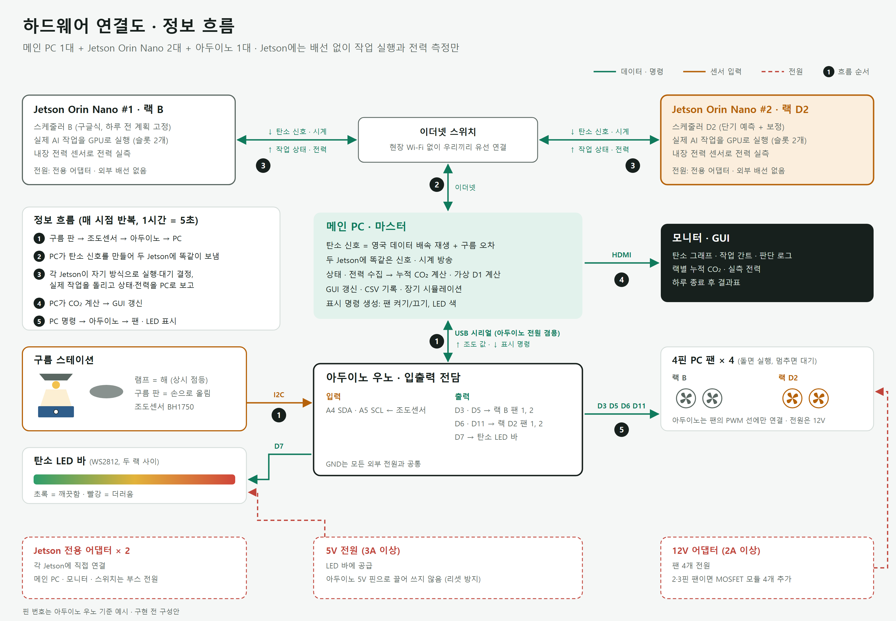

# 우리 프로젝트 쉽게 이해하기

**ICDF_eco: 탄소 인지 AI 데이터센터 스케줄러**
2026 Energy ICDF · 연세대학교 YAX

> 한 문장으로: **AI 작업을 전기가 깨끗한 시간에 돌리도록 하루 전에 계획하고, 날씨 예보가 크게 빗나갔을 때만 계획을 고치는 프로그램**입니다.

---

## 1. 같은 전기라도 "언제" 쓰느냐에 따라 탄소가 다르다

콘센트에서 나오는 전기는 늘 똑같아 보이지만, 그 전기를 만드는 발전소는 시간마다 바뀝니다.

- 바람이 세게 불고 해가 쨍쨍한 시간 → 풍력·태양광 전기가 많음 → **탄소가 적은 전기**
- 바람이 없고 해가 진 저녁 → 가스 발전소를 더 돌림 → **탄소가 많은 전기**

전기 1kWh를 쓸 때 나오는 탄소의 양을 **탄소 집약도**(gCO₂/kWh)라고 부릅니다.
영국 전력망에서는 같은 날 안에서도 이 값이 두 배 가까이 오르내리는 일이 흔합니다.

**비유:** 전기요금이 싼 밤에 세탁기를 돌리면 돈이 아껴지듯, 탄소가 적은 시간에 전기를 쓰면 탄소가 줄어듭니다.

## 2. AI 데이터센터에는 "미뤄도 되는 일"이 많다

AI 데이터센터는 전기를 아주 많이 씁니다. 그런데 하는 일이 모두 급한 건 아닙니다.

| 급한 일 | 미뤄도 되는 일 |
|---|---|
| 지금 들어온 챗봇 질문에 답하기 | AI 모델 학습 (오늘 안에만 끝나면 됨) |
| 실시간 번역 | 밤사이 데이터 정리, 통계 계산 |

미뤄도 되는 일을 **깨끗한 시간으로 옮기면** 같은 일을 하고도 탄소를 덜 배출합니다.
일의 양(전기 사용량)은 그대로이고, **하는 시간만 바뀝니다.**

이 아이디어 자체는 새롭지 않습니다. 구글은 2020년부터 실제 데이터센터에서 이렇게 하고 있습니다.

## 3. 문제: 예보는 틀린다

언제가 깨끗한 시간인지는 **미리 예측**해야 합니다. 그런데 예측은 틀립니다. 바람이 예보보다 약하거나, 예상 못 한 구름이 몰려오면 실제 탄소 값이 예측과 달라집니다.

이때 할 수 있는 선택은 두 가지입니다.

| 방식 | 장점 | 단점 |
|---|---|---|
| **하루 전 계획을 그대로 지킨다** (구글 방식) | 일정이 안정적 | 예보가 틀려도 고치지 않아서 탄소를 덜 줄임 |
| **매 순간 다시 계획한다** | 예보가 틀리면 바로 대응 | 일정이 계속 바뀜. 실제 데이터센터에서는 작업을 자주 옮기면 운영이 흔들림 |

**비유:** 소풍 날짜를 일기예보로 미리 정했는데 당일 아침 구름이 꼈다고 해 봅시다.
- 무조건 간다 → 비 맞을 수 있음
- 구름 한 점만 보여도 날짜를 바꾼다 → 친구들이 지침
- **비가 오래 올 것 같을 때만 미룬다** → 저희 방식

## 4. 우리 아이디어: "오래갈 것 같을 때만, 이득이 클 때만" 고친다

저희 스케줄러(이름: **D2**)는 이렇게 움직입니다.

1. **하루 전**: 내일 탄소 값을 예측하고, 미뤄도 되는 작업을 깨끗할 것 같은 시간에 배치합니다.
2. **당일, 30분마다**: 실제 탄소 값과 예측을 비교해 **얼마나 틀렸는지**(오차)를 봅니다.
3. **이 오차가 앞으로도 이어질까?** 를 예측합니다. 잠깐 지나가는 구름인지, 오래 머물 구름인지를 지난 데이터로 학습한 모델이 판단합니다.
4. **옮기면 얼마나 이득일까?** 를 계산합니다. 줄어드는 탄소가 **변경 비용(람다, λ)** 보다 클 때만 작업을 옮깁니다.
5. 급한 작업은 절대 옮기지 않고, 마감은 항상 지킵니다.

결과적으로 **계획은 거의 그대로 유지**하면서, 정말 필요한 순간에만 고칩니다.

## 5. 부스에서 보는 것

> 그림은 처음 구상안입니다. 지금 구현에서는 두 스케줄러 모두 메인 PC에서 돌고, Jetson은 작업 실행과 전력 측정만 맡습니다. 구름은 조도센서 대신 화면 버튼(스페이스)으로 넣습니다.

| 보이는 것 | 의미 |
|---|---|
| 랙 두 개 | 작은 데이터센터 두 개. 일과 조건은 똑같고 **스케줄러만 다름** |
| 왼쪽 **B 랙** | 하루 전 계획을 그대로 지킴 (구글 방식) |
| 오른쪽 **D2 랙** | 저희 방식 |
| 팬 | 돌고 있는 AI 작업 하나 = 팬 하나 |
| 가운데 LED 바 | 지금 전기가 얼마나 깨끗한지. 초록 = 깨끗, 빨강 = 탄소 많음 |
| 구름 버튼 | 예보에 없던 구름이 와서 탄소 값이 올라간 상황을 만듦 |
| 모니터 | 탄소 그래프, 두 랙의 작업 일정, 누적 탄소 배출량 |

영국의 실제 하루치 데이터를 **2분**으로 빠르게 돌립니다.

- **구름이 잠깐 왔다 가면** → 두 랙 모두 계획을 바꾸지 않습니다.
- **구름이 오래 머물면** → D2 랙만 작업을 나중으로 미루고 팬을 멈춥니다. 하루가 끝나면 D2가 탄소를 덜 배출합니다.

## 6. 진짜로 효과가 있나? (실험 결과)

부스 시연은 보여 주기 위한 장면이라, 효과는 실제 데이터로 따로 확인했습니다.
**영국 전력망의 실제 데이터 685일치**(2025년 1월 ~ 2026년 11월)로 여러 방식을 똑같은 조건에서 비교했습니다.

| 방식 | 하루에 계획을 바꾼 횟수 | 예보가 틀려서 놓친 탄소 중 되찾은 비율 |
|---|---|---|
| 하루 전 계획 고정 (구글 방식) | 0번 | 0% (기준) |
| 매 순간 다시 계획 | 4.1번 | 8.9% |
| 지금 오차만 보고 반응 | 5.7번 | 2.3% |
| **D2 (저희 방식)** | **2.4번** | **9.6%** |

**읽는 법:** 저희 방식은 매 순간 다시 계획하는 방식보다 **계획을 절반만 바꾸고도, 놓친 탄소를 비슷하게(조금 더) 되찾았습니다.**
"지금 오차만 보고 반응"하는 방식은 바꾸기는 가장 많이 바꾸는데 효과는 작습니다. 오차가 **이어질지**를 예측하는 게 중요하다는 뜻입니다.

## 7. 솔직한 한계

- **절대적인 감소량은 아직 작습니다.** 구글 방식 대비 전체 탄소가 약 0.5% 줄어드는 수준입니다. 예보 오차로 놓친 탄소 자체가 크지 않기 때문입니다.
- **지금은 작업을 뒤로 미루기만 합니다.** 예보보다 깨끗해졌을 때 앞당기는 기능은 아직 없습니다.
- **영국 데이터로만 확인했습니다.** 한국 전력망에서는 따로 검증해야 합니다.
- **탄소 배출은 추정치입니다.** 작업 하나가 쓰는 전력량은 가정값이고, 영국의 "실제" 탄소 값도 사후 추정치입니다.
- **작업 목록은 가상입니다.** 실제 데이터센터의 작업 분포로 바꾸면 결과가 달라질 수 있습니다.

## 8. 용어 정리

| 용어 | 뜻 |
|---|---|
| 탄소 집약도 | 전기 1kWh를 만들 때 나오는 탄소의 양 (gCO₂/kWh). 낮을수록 깨끗한 전기 |
| 스케줄러 | 어떤 작업을 언제 돌릴지 정하는 프로그램 |
| 하루 전 예측 | 전날 낮 12시에 내놓는 다음 날 24시간 탄소 집약도 예측. 저희가 직접 학습한 모델 사용 |
| 오차 | 실제 값 − 예측 값. 구름이 오면 오차가 커짐 |
| 슬롯 | 30분 한 칸. 하루 = 48칸 |
| 람다 (λ) | 계획을 한 번 바꾸는 데 드는 "비용"을 탄소 g으로 나타낸 값. 이것보다 이득이 커야 옮김 |
| B | 하루 전 계획을 그대로 실행하는 비교 대상 (구글 방식) |
| D2 | 오차 지속 예측 + 이득-비용 비교로 필요할 때만 고치는 저희 방식 |
| 회복률 | 예보가 틀려서 놓친 탄소 중 몇 %를 되찾았는가 |

## 더 자세히 보려면

| 문서 | 내용 |
|---|---|
| [프로젝트_설명.md](프로젝트_설명.md) | 처음 기획 문서 (연구 질문, 비교 실험 설계) |
| [../sim/README.md](../sim/README.md) | 예측 모델과 장기 시뮬레이션 결과 전체 |
| [시연_가이드.md](시연_가이드.md) | 부스 시연 진행 방법과 설명 대본 |
| [진행상황.md](진행상황.md) | 지금까지 한 일과 남은 일 |
| [참고자료.md](참고자료.md) | 영국 탄소 데이터 출처 |
