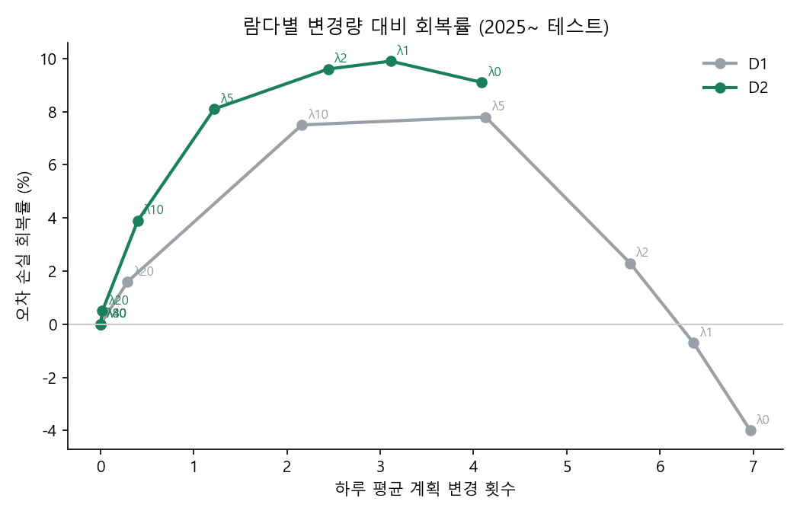

# 장기 시뮬레이션 (메인 PC)

## 하루 전 예측 모델 학습 (`train_forecast.py`)

```bash
# 2017-09-12 ~ 2026-11-16 데이터는 저장소에 포함되어 있어 바로 학습 가능
python sim/train_forecast.py
```

- 16초 정도 걸립니다. 기준선 3개와 Ridge, GradientBoosting의 MAE를 비교합니다.
- 가장 좋은 모델은 `models/dayahead.joblib`(저장소에 안 올림), 2024년 이후 예측은 `data/forecast/dayahead_ours.csv`(저장소에 포함)에 저장됩니다.
- 시연 엔진에서 우리 예측을 쓰려면 `python -m controller.main --day 2025-03-10 --ours ...`
- D일 예측은 D-1일 낮 12시(UTC)에 낸다고 가정합니다 (`--cutoff 24`).

2026-11-17 첫 실행 결과 (MAE, gCO2/kWh):

| 방법 | 검증 2024 | 테스트 2025~ |
|---|---|---|
| 기준선: 마지막 관측값 유지 | 45.4 | 48.2 |
| 기준선: 이틀 전 같은 시각 | 51.4 | 47.3 |
| 기준선: 일주일 전 같은 시각 | 56.8 | 54.7 |
| **Ridge** | **38.5** | **37.2** |
| GradientBoosting | 41.5 | 39.5 |
| (참고) API 단기 forecast | | 9.6 |

API forecast가 훨씬 정확한 건 하루 전이 아니라 직전에 낸 예측이기 때문입니다. 비교 대상이 아닙니다.

**ERROR_DECAY 주의:** 스크립트가 출력하는 오차 자기상관(0.987)은 전력망 예측 오차가 매우 오래 이어진다는 뜻입니다.
이 값을 그대로 `ERROR_DECAY`에 넣으면 D2가 "구름이 영원히 안 걷힌다"고 보고 작업을 옮기지 않습니다 (긴 구름에서도 변경 0회 확인).
부스 시연의 구름은 걷히는 오차이므로 시연에서는 0.85를 유지하고, 장기 시뮬레이션에서 따로 조정합니다.

## 당일 오차 지속 모델 (`train_error_persistence.py`)

D2의 ④번 "지금 오차가 얼마나 이어질지" 예측입니다. `train_forecast.py`를 먼저 돌려야 합니다.

```bash
python sim/train_error_persistence.py
```

- 오차 = 실제 − 우리 하루 전 예측. 최근 8칸(4시간) 오차로 h칸 뒤 오차를 맞춥니다 (h마다 선형 회귀).
- 학습 2024 · 평가 2025~. 결과는 `controller/error_model.json`(계수만 있는 작은 파일, 저장소에 포함).
- `controller/config.py`의 `ERROR_MODEL = "learned"`(기본값)이면 D2가 이 모델을 씁니다. `"rule"`이면 예전 규칙.

2026-11-17 첫 실행 결과 (평가 2025~, MAE gCO2/kWh, h 1~47 평균):

| 방법 | 의미 | MAE |
|---|---|---|
| 0으로 보기 | 오차는 바로 사라진다 (B의 관점) | 37.2 |
| 지금 오차 유지 | 지금 오차가 그대로 간다 (D1) | 33.7 |
| 규칙 EMA×0.85^h | 예전 D2 | 33.6 |
| **학습 모델** | **D2** | **28.4** |

가까운 미래(30분~2시간)는 "지금 오차 유지"와 비슷하고, 8시간 이상 뒤로 갈수록 학습 모델이 확실히 낫습니다.

시연 엔진 확인 (`--ours`, 2025-03-10 / 06-15 / 10-01):
- 구름 없음, 짧은 구름(10-11): 세 날 모두 D2 변경 0회
- 긴 구름(8-22): D2 변경 4~6회, 누적 탄소 B보다 6~15% 낮음
- 부스의 구름은 인위적인 계단 모양이라, 시연 수치로 규칙과 학습 모델의 우열을 말하면 안 됩니다. 평가는 장기 시뮬레이션으로 합니다.

## 장기 시뮬레이션 (`run_longterm.py`)

같은 작업 큐, 같은 마감으로 A·B·C·D1·D2·완벽 예측(P)을 날마다 돌려 합칩니다. 몇 초면 끝납니다.

```bash
python sim/run_longterm.py --period val --lam 2      # 1) 검증(2024)에서 람다 곡선 보고 람다 고르기
python sim/run_longterm.py --period test --lam 2     # 2) 고른 람다로 테스트(2025~) 평가
python sim/run_longterm.py --period test --lam 2 --jobs random   # 날마다 다른 무작위 작업 큐
```

결과: `sim/results/` (요약 CSV, 람다별 CSV, 람다 곡선 그래프)

| 전략 | 뜻 |
|---|---|
| A 즉시 실행 | 작업을 가능한 한 빨리 |
| B 하루 전 고정 | 우리 하루 전 예측으로 계획, 그대로 실행 (구글식) |
| C 매 시점 재계획 | 이득이 조금이라도 있으면 옮김 (람다 0, 예산 없음) |
| D1 Δ에만 반응 | 지금 슬롯이 예측보다 더러운지만 보고 보정, 미래는 원래 예측대로 |
| D2 우리 방식 | 학습한 오차 지속 모델 + 람다 기준 보정 |
| P 완벽 예측 | 실제 값을 미리 알고 계획 (상한) |

**오차 손실 회복률** = (B − X) ÷ (B − P). B가 예측 오차 때문에 놓친 탄소 중 몇 %를 되찾았나.

### 2026-11-17 첫 결과 (람다 2는 검증 기간에서 고름, 테스트는 이 설정으로 한 번 실행)

테스트 2025-01-01 ~ 2026-11-16 (685일), 기본 작업 큐:

| 전략 | 하루 평균 변경 | 회복률 |
|---|---|---|
| B 하루 전 고정 | 0 | 0% |
| C 매 시점 재계획 | 4.12 | 8.9% |
| D1 Δ에만 반응 | 5.68 | 2.3% |
| **D2 우리 방식** | **2.44** | **9.6%** |

무작위 작업 큐: C 3.41회 · 10.1% / D1 5.90회 · −13.4% / **D2 1.66회 · 11.1%**



읽는 법
- D2는 매 시점 재계획(C)보다 변경을 절반 정도만 하면서 회복률은 같거나 조금 높습니다.
- 같은 변경 횟수에서 D2 곡선이 D1보다 항상 위에 있습니다 → 단기 오차 예측이 도움이 됩니다.
- D1은 람다가 작으면 회복률이 마이너스입니다 (지금만 보고 옮겼다가 더 나빠짐).

솔직한 한계
- 회복률이 약 10%입니다. B와 P의 차이(테스트 약 40 kg, B의 6%) 중 10%라서, B 대비 절대 감소는 0.5% 남짓입니다.
- 보정은 작업을 뒤로 미루기만 합니다. 앞당기기, 남은 작업 전체 재배치는 TODO입니다.
- 탄소는 실제 탄소 집약도 × 가정 전력량(`KWH_PER_SLOT`)으로 계산한 추정치입니다. 비율 지표(회복률, %)는 전력량 가정과 무관합니다.
- 작업 큐는 가정입니다. 실제 데이터센터 작업 분포로 바꾸면 결과가 달라질 수 있습니다.
- 시연 엔진의 기본 람다는 10입니다 (부스 구름 장면에 맞춘 값). 장기 시뮬레이션의 람다 2와 다릅니다.
